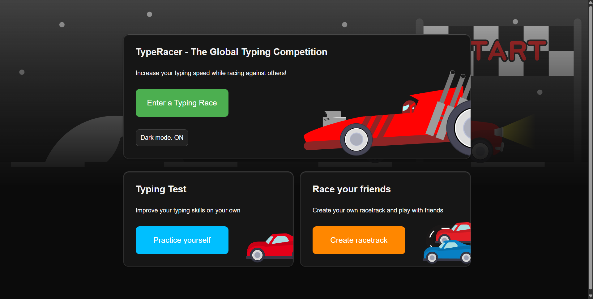
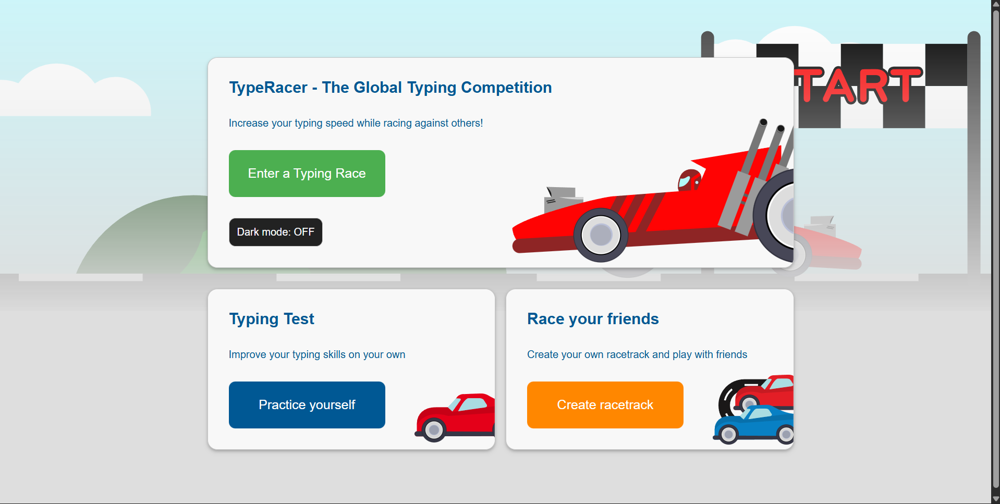
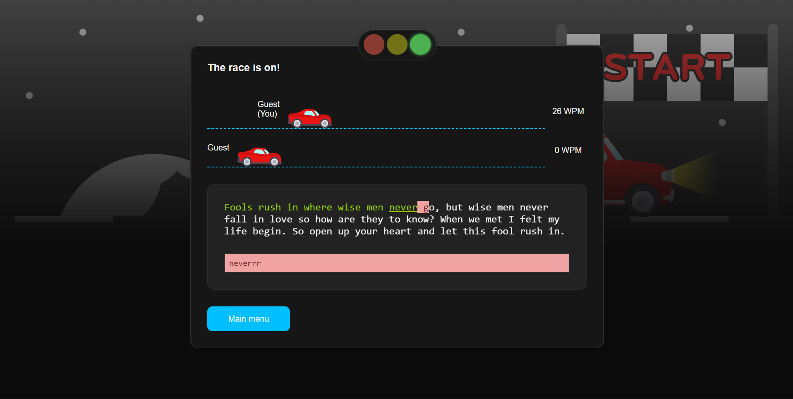
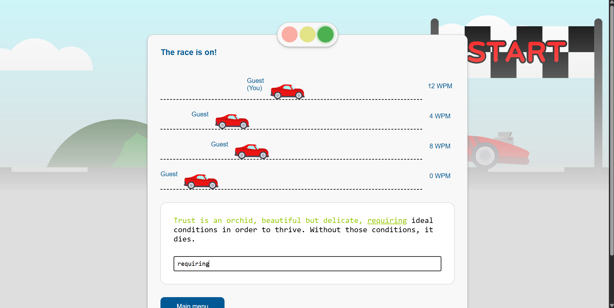

# TypeRacer

A real-time multiplayer typing game. Race other players, practice on your own, or create a private racetrack and share the link with friends.

**Live demo:** https://tristanpinzari.github.io/TypeRacer

> **Note:** the backend costs money to run, so it may be disabled. If it is, the demo will load but races won't work.

| Dark mode | Light mode |
| --- | --- |
|  |  |
|  |  |

## Features

- **Public races:** get matched into a race with other players and see everyone's car move as they type.
- **Private racetracks:** create a race, share the link (`?id=<raceId>`), and start it when your friends have joined.
- **Typing test:** practice solo on a random passage.
- **Live stats:** WPM updates for every racer in real time.
- **Mistake feedback:** typos are highlighted as you type.
- **Dark mode:** toggle from the menu.

## Tech stack

- [React 19](https://react.dev) + TypeScript, built with [Vite](https://vite.dev)
- [Appwrite](https://appwrite.io) for the database, realtime subscriptions and serverless functions
- Deployed to GitHub Pages with `gh-pages`

## How it works

The browser never writes race state directly. Joining, creating and starting races, and updating stats all go through the **PlayerManager** Appwrite function, which holds the API key. The client only reads race rows and subscribes to changes over Appwrite Realtime, which is what moves the cars.

| Piece | Location | Purpose |
| --- | --- | --- |
| Frontend | [src/](src/) | Menu, practice, public and private race screens |
| PlayerManager | [functions/PlayerManager/](functions/PlayerManager/) | Player and race lifecycle (`joinRace`, `createPrivateRace`, `startRace`, `endRace`, `updateStats`, ...) and random text selection |
| Janitor | [functions/Janitor/](functions/Janitor/) | Scheduled cleanup that deletes `races` and `players` rows older than 24 hours |

The Appwrite database uses three tables: `races`, `players` and `texts`.

## Running locally

Requires Node.js and an Appwrite project (Appwrite Cloud or self-hosted).

```bash
npm install
npm run dev
```

Copy [.env.example](.env.example) to `.env` and fill in your own values:

```bash
cp .env.example .env
```

`.env` is gitignored. Anything prefixed with `VITE_` is bundled into the frontend, so never put secrets in it.

### Appwrite setup

1. Create a database with the `races`, `players` and `texts` tables.
2. Deploy the two functions from [functions/](functions/). Each needs these environment variables set in Appwrite:
   - `APPWRITE_API_KEY`: a server API key with database access
   - `APPWRITE_DATABASE_ID`: your database id
3. Run Janitor on a schedule (for example daily) so stale rows get cleaned up.
4. Add some passages to the `texts` table (`content`, `origin`, `author`, `type`, `uploader`).

## Scripts

| Command | Description |
| --- | --- |
| `npm run dev` | Start the dev server |
| `npm run build` | Type-check and build to `dist/` |
| `npm run preview` | Preview the production build |
| `npm run lint` | Run ESLint |
| `npm run deploy` | Build and publish `dist/` to GitHub Pages |
